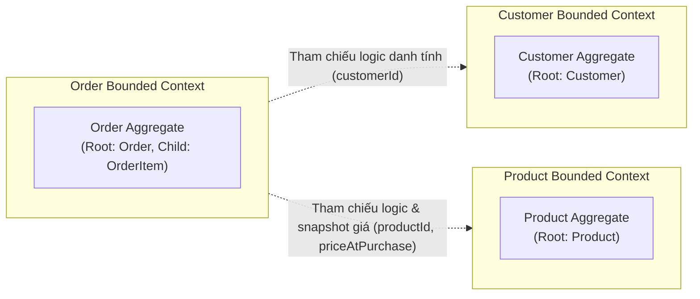
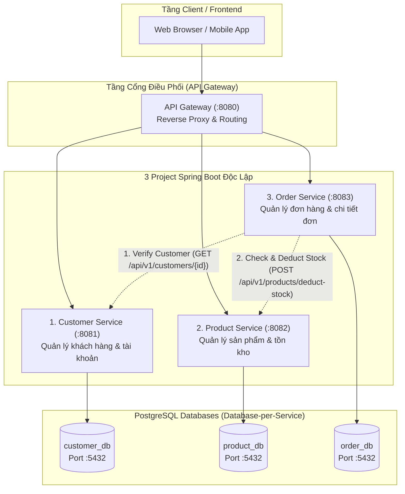
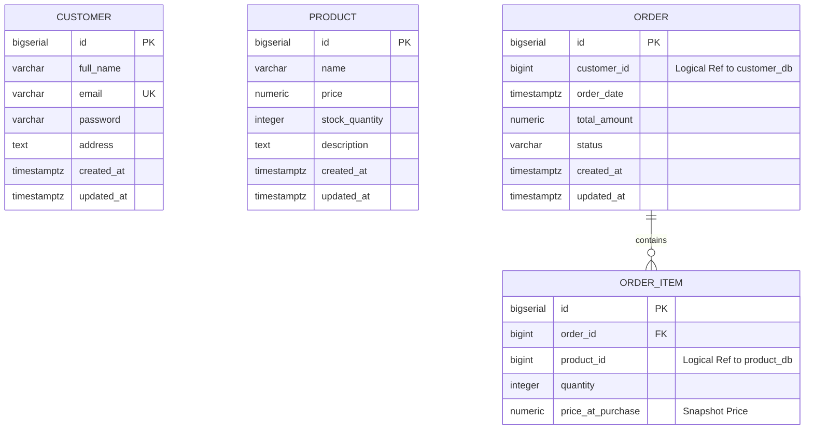
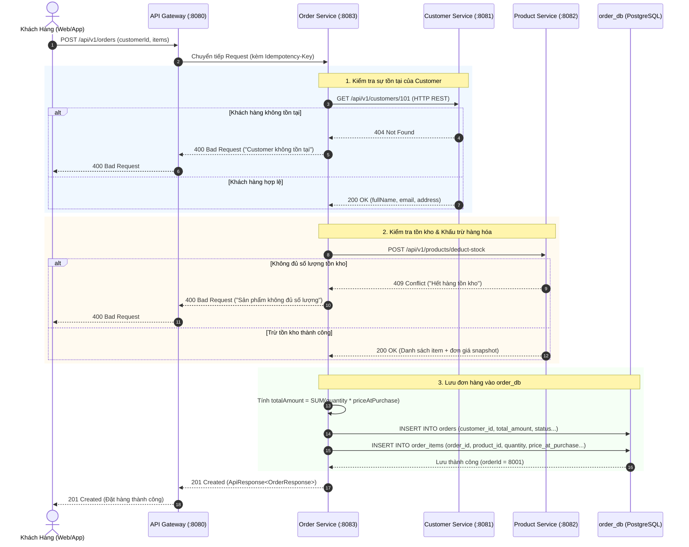

# BÀI TẬP: THIẾT KẾ KIẾN TRÚC PHÂN RÃ (DECOMPOSITION)
## HỆ THỐNG THƯƠNG MẠI ĐIỆN TỬ (ECOMMERCE MICROSERVICES)

> **Môn học / Chuyên đề:** Microservices Architecture & Domain-Driven Design (DDD)  
> **Bài học áp dụng:** Phân tách module (S1-L4) & Tư duy DDD (S1-L3)  
> **Công nghệ áp dụng:** Java 17 LTS, Spring Boot 3.x / 4.x, PostgreSQL 15+, Gradle  
> **Kiến trúc cốt lõi:** Database-per-Service, Loose Coupling, Zero Shared-Database, Zero In-Memory Code Call  

---

## MỤC LỤC
1. [Mục Tiêu & Yêu Cầu Thiết Kế](#1-mục-tiêu--yêu-cầu-thiết-kế)
2. [Phân Tích Bounded Context & Capability Map (DDD S1-L3 & S1-L4)](#2-phân-tích-bounded-context--capability-map-ddd-s1-l3--s1-l4)
3. [Tổng Quan Kiến Trúc Hệ Thống (Decomposition Architecture)](#3-tổng-quan-kiến-trúc-hệ-thống-decomposition-architecture)
4. [Bản Ghi Quyết Định Kiến Trúc (ADR): Tại Sao Order Chỉ Lưu customerId?](#4-bản-ghi-quyết-định-kiến-trúc-adr-tại-sao-order-chỉ-lưu-customerid)
5. [Cấu Trúc Thư Mục Chuẩn 3 Project Spring Boot Độc Lập](#5-cấu-trúc-thư-mục-chuẩn-3-project-spring-boot-độc-lập)
6. [Mẫu Cấu Hình Build Gradle & application.properties](#6-mẫu-cấu-hình-build-gradle--applicationproperties)
7. [Thiết Kế Cơ Sở Dữ Liệu PostgreSQL (Database-per-Service)](#7-thiết-kế-cơ-sở-dữ-liệu-postgresql-database-per-service)
8. [Mã Nguồn Thực Thể JPA (Entity Classes)](#8-mã-nguồn-thực-thể-jpa-entity-classes)
9. [Đặc Tả API RESTful & Hợp Đồng Dữ Liệu](#9-đặc-tả-api-restful--hợp-đồng-dữ-liệu)
10. [Luồng Nghiệp Vụ Tạo Đơn Hàng (Sequence Diagram)](#10-luồng-nghiệp-vụ-tạo-đơn-hàng-sequence-diagram)

---

## 1. MỤC TIÊU & YÊU CẦU THIẾT KẾ

### 1.1. Mục tiêu
- **Kiến thức:** Nắm vững và vận dụng các nguyên lý phân rã module (S1-L4) và tư duy Domain-Driven Design (S1-L3).
- **Kỹ năng:** Xác định ranh giới (Boundaries) giữa các dịch vụ, thiết kế thực thể (Entities), thiết kế CSDL riêng biệt và xây dựng giao tiếp phân tán an toàn.

### 1.2. Yêu cầu chi tiết
- Phân tách hệ thống TMĐT thành **3 project Spring Boot hoàn toàn độc lập**:
  1. **Customer Service**: Thực thể `Customer` (`id`, `fullName`, `email`, `password`, `address`).
  2. **Product Service**: Thực thể `Product` (`id`, `name`, `price`, `stockQuantity`, `description`).
  3. **Order Service**: Thực thể `Order` (`id`, `customerId`, `orderDate`, `totalAmount`, `status`) và `OrderItem` (`id`, `orderId`, `productId`, `quantity`, `priceAtPurchase`).
- **Ràng buộc bất biến:**
  - Tuyệt đối **không dùng chung Database** (Mỗi service sở hữu 1 PostgreSQL schema/database riêng).
  - Tuyệt đối **không gọi trực tiếp code** của nhau (Không chia sẻ Entity class qua file JAR chung, không gọi method in-process; chỉ giao tiếp qua mạng qua REST API HTTP/JSON).
  - Trả lời và biện luận chi tiết: **Tại sao Order chỉ nên lưu `customerId` mà không lưu cả đối tượng `Customer`?**

---

## 2. PHÂN TÍCH BOUNDED CONTEXT & CAPABILITY MAP (DDD S1-L3 & S1-L4)

### 2.1. Phân định Bounded Contexts
Trong DDD, một hệ thống lớn được chia thành các **Bounded Context** (Ranh giới ngữ cảnh). Mỗi ngữ cảnh có mô hình ngôn ngữ chung (Ubiquitous Language) và Aggregate Root riêng quản lý các bất biến nghiệp vụ:



### 2.2. Bảng Phân Rã Năng Lực (Capability Map)

| Module ID | Bounded Context | Trách Nhiệm Nghiệp Vụ Cốt Lõi | Phụ Thuộc (Depends on) | Thứ Tự Xây Dựng (Build Order) |
| :--- | :--- | :--- | :--- | :---: |
| `customer-service` | **Customer Management** | Quản lý hồ sơ định danh người dùng, xác thực (Auth/Credential), địa chỉ cá nhân. | Độc lập (None) | **1** |
| `product-service` | **Product Catalog & Inventory** | Quản lý danh mục hàng hóa, giá niêm yết hiện tại, số lượng tồn kho khả dụng. | Độc lập (None) | **2** |
| `order-service` | **Order Processing & Fulfillment** | Xử lý vòng đời đơn hàng, tính toán giá trị thanh toán, chốt thông tin giao dịch tại thời điểm mua. | `customer-service`, `product-service` (qua REST API) | **3** |

---

## 3. TỔNG QUAN KIẾN TRÚC HỆ THỐNG (DECOMPOSITION ARCHITECTURE)

Hệ thống được tổ chức thành 3 project Spring Boot độc lập giao tiếp qua REST API (HTTP/JSON):



### Bảng Phân Công & Trách Nhiệm Dịch Vụ
| STT | Tên Service | Port | Database PostgreSQL | Trách nhiệm chính |
| :---: | :--- | :---: | :--- | :--- |
| **1** | **Customer Service** | `8081` | `customer_db` | Đăng ký, đăng nhập, bảo vệ thông tin cá nhân và mật khẩu của khách hàng. |
| **2** | **Product Service** | `8082` | `product_db` | Quản lý thông tin hàng hóa, biến động giá niêm yết, kiểm tra và trừ tồn kho (`stockQuantity`). |
| **3** | **Order Service** | `8083` | `order_db` | Tạo đơn hàng, theo dõi trạng thái (`PENDING`, `CONFIRMED`, `SHIPPED`, `CANCELLED`), snapshot giá mua. |

---

## 4. BẢN GHI QUYẾT ĐỊNH KIẾN TRÚC (ADR): TẠI SAO ORDER CHỈ LƯU `customerId`?

> **Mã ADR:** `ADR-001`  
> **Trạng thái:** `APPROVED`  
> **Vấn đề đặt ra:** Tại sao trong kiến trúc phân rã, thực thể `Order` chỉ nên lưu `customerId` mà không được phép lưu cả đối tượng `Customer`?

```
┌────────────────────────────────────────────────────────────────────────┐
│                              BỐI CẢNH                                  │
│  Khi người dùng đặt hàng, đơn hàng thuộc về một khách hàng cụ thể.     │
│  Lập trình viên thường quen tư duy Monolith: nhúng đối tượng Customer  │
│  hoặc bảng Order liên kết Foreign Key vật lý với bảng Customer.        │
└──────────────────────────────────┬─────────────────────────────────────┘
                                   │
                                   ▼
┌────────────────────────────────────────────────────────────────────────┐
│                        QUYẾT ĐỊNH KIẾN TRÚC                            │
│  Trong Order Service, thực thể Order CHỈ LƯU thuộc tính 'customerId'   │
│  (Logical Identity Reference). TUYỆT ĐỐI KHÔNG LƯU ĐỐI TƯỢNG Customer. │
└────────────────────────────────────────────────────────────────────────┘
```

### 6 Lý Do Kỹ Thuật & Nguyên Lý Cốt Lõi:

#### 1. Ranh giới Aggregate Root & Bounded Context (DDD S1-L3)
- Trong DDD, `Customer` là **Aggregate Root** của *Customer Context*, còn `Order` là **Aggregate Root** của *Order Context*.
- **Quy tắc vàng của Eric Evans (Domain-Driven Design)**: *Một Aggregate Root chỉ được tham chiếu đến một Aggregate Root khác thông qua Identity (ID), không bao giờ nắm giữ tham chiếu đối tượng trực tiếp.*
- Nếu `Order` giữ đối tượng `Customer`, ranh giới quản lý vòng đời (Lifecycle) và tính bất biến (Invariants) của hai miền bị vi phạm.

#### 2. Phá vỡ Khớp Nối Chặt (Loose Coupling) & Tránh "Distributed Monolith"
- Nếu `Order` lưu nguyên đối tượng `Customer`, mỗi khi `Customer` thay đổi cấu trúc class (ví dụ: thêm trường `avatarUrl`, sửa `address` thành Value Object `AddressLine`, `City`, `District`), `Order Service` bắt buộc phải cập nhật code, compile lại và deploy lại.
- Chỉ lưu `customerId` tạo ra sự độc lập triển khai (Autonomous Deployment). Đội ngũ phát triển `customer-service` có thể thoải mái tiến hóa mô hình nội bộ mà không làm gãy vỡ `order-service`.

#### 3. Nguồn Chân Lý Duy Nhất (Single Source of Truth - SSOT) & Chống Dư Thừa Dữ Liệu
- Dữ liệu khách hàng biến động theo thời gian: Khách hàng đổi tên (`fullName`), đổi mật khẩu (`password`), cập nhật địa chỉ mặc định (`address`).
- Nếu `Order` lưu cả đối tượng `Customer`:
  - Dữ liệu sẽ bị phân mảnh và bất nhất (Data Inconsistency). Khi khách hàng đổi email ở Customer Service, hàng nghìn đơn hàng cũ trong quá khứ sẽ lưu dữ liệu cũ hoặc hệ thống phải chạy batch update khổng lồ để đồng bộ sang Order Service.
  - Với việc chỉ lưu `customerId`, `Customer Service` luôn là nguồn chân lý duy nhất (SSOT) cho mọi thông tin hồ sơ người dùng.

#### 4. Phân Biệt "Snapshot Dữ Liệu Lịch Sử" vs "Tham Chiếu Danh Tính"
- Nghiệp vụ TMĐT cần phân biệt rõ:
  - **Danh tính người đặt (Who placed it)**: Là một thực thể danh tính lâu dài $\rightarrow$ Lưu `customerId`.
  - **Địa chỉ giao hàng thực tế (Where to deliver)**: Tại thời điểm đặt hàng, khách hàng có thể chọn giao về nhà riêng hoặc công ty. Đây là **Snapshot Data** (Dữ liệu chốt tại thời điểm giao dịch), thuộc về thuộc tính của đơn hàng (ví dụ: `shippingAddress`), chứ không phải đối tượng Customer.

#### 5. An Toàn Thông Tin & Nguyên Tắc Tối Thiểu Đặc Quyền (Least Privilege)
- Thực thể `Customer` chứa thông tin nhạy cảm bảo mật: `password` (đã hash), salt, token xác thực, trạng thái tài khoản.
- `Order Service` chỉ làm nhiệm vụ tính tiền và quản lý đơn. Việc nạp hoặc lưu đối tượng `Customer` bên trong cơ sở dữ liệu `order_db` gây ra vi phạm nghiêm trọng về an toàn thông tin (Data Leakage) và quy chuẩn bảo mật (GDPR/ISO 27001). `Order Service` hoàn toàn không có lý do nghiệp vụ nào để biết hay lưu `password` của khách hàng.

#### 6. Độc Lập Cơ Sở Dữ Liệu (Database-per-Service Pattern)
- CSDL `customer_db` và `order_db` là 2 database vật lý tách biệt.
- Không thể tạo khóa ngoại SQL (`FOREIGN KEY`) xuyên qua 2 database engine. Do đó, việc lưu một object quan hệ lồng nhau (`@ManyToOne Customer customer`) của Hibernate JPA sẽ bị phá vỡ hoàn toàn tại tầng CSDL.

---

## 5. CẤU TRÚC THƯ MỤC CHUẨN 3 PROJECT SPRING BOOT ĐỘC LẬP

Mỗi service là một Gradle project độc lập, tuân thủ kiến trúc phân tầng Layered Architecture:

```plaintext
buoi3/
├── customer-service/                  # Project 1: Port 8081
│   ├── src/main/java/com/ecommerce/customer/
│   │   ├── config/                    # SecurityConfig, RestClientConfig
│   │   ├── constant/                  # UserRole, ErrorCodes
│   │   ├── controller/                # CustomerController.java
│   │   ├── dto/
│   │   │   ├── request/               # CreateCustomerRequest.java
│   │   │   └── response/              # CustomerResponse.java, ApiResponse.java
│   │   ├── entity/                    # Customer.java
│   │   ├── exception/                 # GlobalExceptionHandler.java
│   │   ├── repository/                # CustomerRepository.java
│   │   ├── service/impl/              # CustomerServiceImpl.java
│   │   └── CustomerServiceApplication.java
│   ├── src/main/resources/
│   │   └── application.properties     # DB: customer_db
│   └── build.gradle
│
├── product-service/                   # Project 2: Port 8082
│   ├── src/main/java/com/ecommerce/product/
│   │   ├── config/
│   │   ├── controller/                # ProductController.java
│   │   ├── dto/
│   │   │   ├── request/               # DeductStockRequest.java
│   │   │   └── response/              # ProductResponse.java, ApiResponse.java
│   │   ├── entity/                    # Product.java
│   │   ├── exception/
│   │   ├── repository/                # ProductRepository.java
│   │   ├── service/impl/              # ProductServiceImpl.java
│   │   └── ProductServiceApplication.java
│   ├── src/main/resources/
│   │   └── application.properties     # DB: product_db
│   └── build.gradle
│
└── order-service/                     # Project 3: Port 8083
    ├── src/main/java/com/ecommerce/order/
    │   ├── client/                    # CustomerClient.java, ProductClient.java
    │   ├── config/                    # RestClientConfig.java
    │   ├── constant/                  # OrderStatus.java
    │   ├── controller/                # OrderController.java
    │   ├── dto/
    │   │   ├── request/               # CreateOrderRequest.java, OrderItemRequest.java
    │   │   └── response/              # OrderResponse.java, ApiResponse.java
    │   ├── entity/                    # Order.java, OrderItem.java
    │   ├── exception/
    │   ├── repository/                # OrderRepository.java
    │   ├── service/impl/              # OrderServiceImpl.java
    │   └── OrderServiceApplication.java
    ├── src/main/resources/
    │   └── application.properties     # DB: order_db
    └── build.gradle
```

---

## 6. MẪU CẤU HÌNH BUILD GRADLE & APPLICATION.PROPERTIES

### 6.1. File `build.gradle` (Chuẩn JDK 17 & Spring Boot 3.x / 4.x)
```groovy
plugins {
    id 'java'
    id 'org.springframework.boot' version '3.3.4'
    id 'io.spring.dependency-management' version '1.1.6'
}

group = 'com.ecommerce'
version = '1.0.0-SNAPSHOT'

java {
    toolchain {
        languageVersion = JavaLanguageVersion.of(17)
    }
}

configurations {
    compileOnly {
        extendsFrom annotationProcessor
    }
}

repositories {
    mavenCentral()
}

dependencies {
    // Spring Boot Core Web & Data JPA
    implementation 'org.springframework.boot:spring-boot-starter-web'
    implementation 'org.springframework.boot:spring-boot-starter-data-jpa'
    implementation 'org.springframework.boot:spring-boot-starter-validation'
    
    // PostgreSQL Driver
    runtimeOnly 'org.postgresql:postgresql'

    // Lombok
    compileOnly 'org.projectlombok:lombok'
    annotationProcessor 'org.projectlombok:lombok'

    // Testing
    testImplementation 'org.springframework.boot:spring-boot-starter-test'
}

tasks.named('test') {
    useJUnitPlatform()
}
```

### 6.2. File `application.properties` Riêng Biệt Từng Service

#### Customer Service (`customer-service/src/main/resources/application.properties`)
```properties
server.port=8081
server.servlet.context-path=/api/v1/customers
spring.application.name=customer-service

# PostgreSQL Database: customer_db
spring.datasource.url=jdbc:postgresql://localhost:5432/customer_db
spring.datasource.username=postgres
spring.datasource.password=postgres
spring.datasource.driver-class-name=org.postgresql.Driver

spring.jpa.hibernate.ddl-auto=update
spring.jpa.show-sql=true
spring.jpa.properties.hibernate.format_sql=true
spring.jpa.properties.hibernate.dialect=org.hibernate.dialect.PostgreSQLDialect
```

#### Product Service (`product-service/src/main/resources/application.properties`)
```properties
server.port=8082
server.servlet.context-path=/api/v1/products
spring.application.name=product-service

# PostgreSQL Database: product_db
spring.datasource.url=jdbc:postgresql://localhost:5432/product_db
spring.datasource.username=postgres
spring.datasource.password=postgres
spring.datasource.driver-class-name=org.postgresql.Driver

spring.jpa.hibernate.ddl-auto=update
spring.jpa.show-sql=true
spring.jpa.properties.hibernate.format_sql=true
spring.jpa.properties.hibernate.dialect=org.hibernate.dialect.PostgreSQLDialect
```

#### Order Service (`order-service/src/main/resources/application.properties`)
```properties
server.port=8083
server.servlet.context-path=/api/v1/orders
spring.application.name=order-service

# PostgreSQL Database: order_db
spring.datasource.url=jdbc:postgresql://localhost:5432/order_db
spring.datasource.username=postgres
spring.datasource.password=postgres
spring.datasource.driver-class-name=org.postgresql.Driver

spring.jpa.hibernate.ddl-auto=update
spring.jpa.show-sql=true
spring.jpa.properties.hibernate.format_sql=true
spring.jpa.properties.hibernate.dialect=org.hibernate.dialect.PostgreSQLDialect

# Internal Inter-Service REST Endpoints
services.customer-service.base-url=http://localhost:8081/api/v1/customers
services.product-service.base-url=http://localhost:8082/api/v1/products
```

---

## 7. THIẾT KẾ CƠ SỞ DỮ LIỆU POSTGRESQL (DATABASE-PER-SERVICE)

### 7.1. Sơ Đồ Thực Thể Quan Hệ (Mermaid ERD)



### 7.2. Mã DDL PostgreSQL Cho Từng Cơ Sở Dữ Liệu

```sql
-- =============================================
-- 1. DATABASE: customer_db (Port 5432)
-- =============================================
CREATE DATABASE customer_db;
\c customer_db;

CREATE TABLE customers (
    id BIGSERIAL PRIMARY KEY,
    full_name VARCHAR(255) NOT NULL,
    email VARCHAR(255) NOT NULL UNIQUE,
    password VARCHAR(255) NOT NULL,
    address TEXT,
    created_at TIMESTAMP WITH TIME ZONE DEFAULT CURRENT_TIMESTAMP,
    updated_at TIMESTAMP WITH TIME ZONE DEFAULT CURRENT_TIMESTAMP
);
CREATE INDEX idx_customers_email ON customers(email);

-- =============================================
-- 2. DATABASE: product_db (Port 5432)
-- =============================================
CREATE DATABASE product_db;
\c product_db;

CREATE TABLE products (
    id BIGSERIAL PRIMARY KEY,
    name VARCHAR(255) NOT NULL,
    price NUMERIC(15, 2) NOT NULL CHECK (price >= 0),
    stock_quantity INTEGER NOT NULL CHECK (stock_quantity >= 0),
    description TEXT,
    created_at TIMESTAMP WITH TIME ZONE DEFAULT CURRENT_TIMESTAMP,
    updated_at TIMESTAMP WITH TIME ZONE DEFAULT CURRENT_TIMESTAMP
);
CREATE INDEX idx_products_name ON products(name);

-- =============================================
-- 3. DATABASE: order_db (Port 5432)
-- =============================================
CREATE DATABASE order_db;
\c order_db;

CREATE TABLE orders (
    id BIGSERIAL PRIMARY KEY,
    customer_id BIGINT NOT NULL, -- Logical Reference to customer_db.customers(id)
    order_date TIMESTAMP WITH TIME ZONE DEFAULT CURRENT_TIMESTAMP NOT NULL,
    total_amount NUMERIC(15, 2) NOT NULL CHECK (total_amount >= 0),
    status VARCHAR(50) NOT NULL,
    created_at TIMESTAMP WITH TIME ZONE DEFAULT CURRENT_TIMESTAMP,
    updated_at TIMESTAMP WITH TIME ZONE DEFAULT CURRENT_TIMESTAMP
);
CREATE INDEX idx_orders_customer_id ON orders(customer_id);
CREATE INDEX idx_orders_status ON orders(status);

CREATE TABLE order_items (
    id BIGSERIAL PRIMARY KEY,
    order_id BIGINT NOT NULL REFERENCES orders(id) ON DELETE CASCADE,
    product_id BIGINT NOT NULL, -- Logical Reference to product_db.products(id)
    quantity INTEGER NOT NULL CHECK (quantity > 0),
    price_at_purchase NUMERIC(15, 2) NOT NULL CHECK (price_at_purchase >= 0)
);
CREATE INDEX idx_order_items_order_id ON order_items(order_id);
CREATE INDEX idx_order_items_product_id ON order_items(product_id);
```

---

## 8. MÃ NGUỒN THỰC THỂ JPA (ENTITY CLASSES)

### 8.1. Thực Thể `Customer.java` (`customer-service`)
```java
package com.ecommerce.customer.entity;

import jakarta.persistence.*;
import lombok.*;
import org.hibernate.annotations.CreationTimestamp;
import org.hibernate.annotations.UpdateTimestamp;

import java.time.Instant;

@Entity
@Table(name = "customers")
@Getter
@Setter
@NoArgsConstructor
@AllArgsConstructor
@Builder
public class Customer {

    @Id
    @GeneratedValue(strategy = GenerationType.IDENTITY)
    private Long id;

    @Column(name = "full_name", nullable = false)
    private String fullName;

    @Column(name = "email", nullable = false, unique = true)
    private String email;

    @Column(name = "password", nullable = false)
    private String password;

    @Column(name = "address", columnDefinition = "TEXT")
    private String address;

    @CreationTimestamp
    @Column(name = "created_at", updatable = false)
    private Instant createdAt;

    @UpdateTimestamp
    @Column(name = "updated_at")
    private Instant updatedAt;
}
```

### 8.2. Thực Thể `Product.java` (`product-service`)
```java
package com.ecommerce.product.entity;

import jakarta.persistence.*;
import lombok.*;
import org.hibernate.annotations.CreationTimestamp;
import org.hibernate.annotations.UpdateTimestamp;

import java.math.BigDecimal;
import java.time.Instant;

@Entity
@Table(name = "products")
@Getter
@Setter
@NoArgsConstructor
@AllArgsConstructor
@Builder
public class Product {

    @Id
    @GeneratedValue(strategy = GenerationType.IDENTITY)
    private Long id;

    @Column(name = "name", nullable = false)
    private String name;

    @Column(name = "price", nullable = false, precision = 15, scale = 2)
    private BigDecimal price;

    @Column(name = "stock_quantity", nullable = false)
    private Integer stockQuantity;

    @Column(name = "description", columnDefinition = "TEXT")
    private String description;

    @CreationTimestamp
    @Column(name = "created_at", updatable = false)
    private Instant createdAt;

    @UpdateTimestamp
    @Column(name = "updated_at")
    private Instant updatedAt;
}
```

### 8.3. Thực Thể `Order.java` & `OrderItem.java` (`order-service`)
```java
package com.ecommerce.order.entity;

import jakarta.persistence.*;
import lombok.*;
import org.hibernate.annotations.CreationTimestamp;
import org.hibernate.annotations.UpdateTimestamp;

import java.math.BigDecimal;
import java.time.Instant;
import java.util.ArrayList;
import java.util.List;

@Entity
@Table(name = "orders")
@Getter
@Setter
@NoArgsConstructor
@AllArgsConstructor
@Builder
public class Order {

    @Id
    @GeneratedValue(strategy = GenerationType.IDENTITY)
    private Long id;

    // Logical Reference sang Customer Service - KHÔNG DÙNG @ManyToOne Customer
    @Column(name = "customer_id", nullable = false)
    private Long customerId;

    @Column(name = "order_date", nullable = false)
    private Instant orderDate;

    @Column(name = "total_amount", nullable = false, precision = 15, scale = 2)
    private BigDecimal totalAmount;

    @Column(name = "status", nullable = false, length = 50)
    private String status; // PENDING, CONFIRMED, CANCELLED

    @OneToMany(mappedBy = "order", cascade = CascadeType.ALL, orphanRemoval = true)
    @Builder.Default
    private List<OrderItem> items = new ArrayList<>();

    @CreationTimestamp
    @Column(name = "created_at", updatable = false)
    private Instant createdAt;

    @UpdateTimestamp
    @Column(name = "updated_at")
    private Instant updatedAt;

    public void addItem(OrderItem item) {
        items.add(item);
        item.setOrder(this);
    }
}
```

```java
package com.ecommerce.order.entity;

import jakarta.persistence.*;
import lombok.*;

import java.math.BigDecimal;

@Entity
@Table(name = "order_items")
@Getter
@Setter
@NoArgsConstructor
@AllArgsConstructor
@Builder
public class OrderItem {

    @Id
    @GeneratedValue(strategy = GenerationType.IDENTITY)
    private Long id;

    @ManyToOne(fetch = FetchType.LAZY)
    @JoinColumn(name = "order_id", nullable = false)
    private Order order;

    // Logical Reference sang Product Service - KHÔNG DÙNG @ManyToOne Product
    @Column(name = "product_id", nullable = false)
    private Long productId;

    @Column(name = "quantity", nullable = false)
    private Integer quantity;

    @Column(name = "price_at_purchase", nullable = false, precision = 15, scale = 2)
    private BigDecimal priceAtPurchase;
}
```

---

## 9. ĐẶC TẢ API RESTFUL & HỢP ĐỒNG DỮ LIỆU

### 9.1. Lớp Bọc Phản Hồi Chung (`ApiResponse<T>`)
```java
package com.ecommerce.order.dto.response;

import com.fasterxml.jackson.annotation.JsonInclude;
import lombok.*;

@Getter
@Setter
@Builder
@AllArgsConstructor
@NoArgsConstructor
@JsonInclude(JsonInclude.Include.NON_NULL)
public class ApiResponse<T> {
    private int code;
    private String message;
    private T data;
}
```

### 9.2. Danh Sách API Liên Dịch Vụ Cốt Lõi

#### API 1: Customer Service - Xác thực khách hàng
- **Method & Endpoint**: `GET /api/v1/customers/{id}`
- **Response**: `200 OK`
```json
{
  "code": 200,
  "message": "Lấy thông tin khách hàng thành công",
  "data": {
    "id": 101,
    "fullName": "Nguyễn Văn A",
    "email": "nguyenvana@gmail.com",
    "address": "123 Cầu Giấy, Hà Nội"
  }
}
```

#### API 2: Product Service - Kiểm tra tồn kho & Khấu trừ hàng
- **Method & Endpoint**: `POST /api/v1/products/deduct-stock`
- **Request Body**:
```json
{
  "items": [
    {
      "productId": 1,
      "quantity": 2
    }
  ]
}
```
- **Response**: `200 OK`
```json
{
  "code": 200,
  "message": "Trừ tồn kho thành công",
  "data": {
    "deductedItems": [
      {
        "productId": 1,
        "productName": "Bàn phím cơ DareU",
        "unitPrice": 1200000.00,
        "quantity": 2
      }
    ]
  }
}
```

#### API 3: Order Service - Khởi tạo đơn hàng mới
- **Method & Endpoint**: `POST /api/v1/orders`
- **Headers**:
  - `Idempotency-Key: c9d8e7f6-a1b2-4c3d-8e9f-0a1b2c3d4e5f`
- **Request Body**:
```json
{
  "customerId": 101,
  "items": [
    {
      "productId": 1,
      "quantity": 2
    }
  ]
}
```
- **Response**: `201 CREATED`
```json
{
  "code": 201,
  "message": "Tạo đơn hàng thành công",
  "data": {
    "orderId": 8001,
    "customerId": 101,
    "orderDate": "2026-10-10T14:00:00Z",
    "totalAmount": 2400000.00,
    "status": "CONFIRMED",
    "items": [
      {
        "productId": 1,
        "quantity": 2,
        "priceAtPurchase": 1200000.00
      }
    ]
  }
}
```

---

## 10. LUỒNG NGHIỆP VỤ TẠO ĐƠN HÀNG (SEQUENCE DIAGRAM)



---

## 11. KẾT LUẬN & BÀI HỌC KINH NGHIỆM
- **Tư duy phân tách module (S1-L4)**: Microservices không đơn thuần là chia nhỏ project code, mà là **chia nhỏ quyền sở hữu dữ liệu (Data Ownership)**. Việc triệt tiêu quan hệ Foreign Key vật lý giữa các database giúp mỗi service có khả năng scale độc lập (Independent Scalability).
- **Tư duy DDD (S1-L3)**: Thiết kế ranh giới Aggregate Root chuẩn xác ngăn chặn tình trạng trộn lẫn trách nhiệm nghiệp vụ, bảo vệ tính toàn vẹn dữ liệu và đảm bảo an toàn thông tin (Security & Data Isolation).
